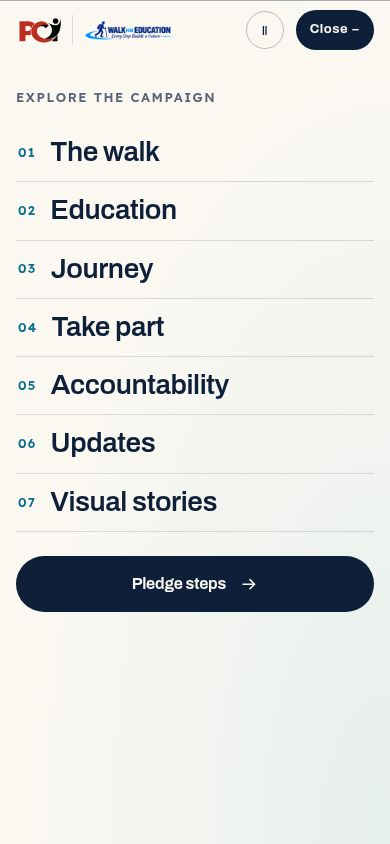

# Campaign menu and motion audit — 22 October 2026

The Walk for Education menu is repaired and its existing story motion is extended with small, composable
details. The current Archivo/Lexend typography, campaign palette, content and URLs are retained.

## Findings and repairs

| Finding | Evidence | Result |
| --- | --- | --- |
| The full-screen menu collapsed into the header. | In the source preview at 390 × 844 px, opening the menu enabled `backdrop-filter` on `.w-header`; `#wfeMenu` measured only 104 px tall. The fixed descendant used the filtered header as its containing block. | Blur moves to an independent pseudo-element. The header stays unfiltered and unclipped. The menu measures 844 px, starts at viewport top and scrolls internally on short screens. |
| Two scripts shared menu state and focus. | The shell toggled `.is-open`, while a MutationObserver in the redesign script separately changed body overflow, background inertness and focus. | The shell owns the entire menu lifecycle; the redesign only highlights the current section. |
| Overflow-only locking did not preserve a phone's page position reliably. | The old controller only wrote `body.style.overflow`, with no saved scroll position or page-lifecycle cleanup. | Fixed-body locking stores the position and prior styles. Escape, the close button, link navigation, desktop resizing and page departure restore them. Back-forward restoration clears any lock. |
| Background state was overwritten. | The old observer always reset main and footer inertness to `false`. | Each affected element's prior inert state is restored. The closed mobile navigation is inert; desktop navigation remains usable. |
| Fixed-body locking could reset scroll scenes. | Locking a page can report scroll zero while its body remains offset. | Story scenes and sticky updates suspend while the menu owns the scroll lock. |
| Smaller components had little motion compared with the main chapters. | Existing motion concentrated on the hero, backpack, learning chapters, route and five-friends scene. | Additional details animate on arrival and follow the existing pause, reduced-motion and data-saver settings. |

## Motion additions

- A full-height menu wipe, staggered links, an exploration label and a clear closing state.
- A finite floating campus inset and fine-pointer portrait depth.
- Bounded image drift in learning, journey and partnership scenes (smaller on phones).
- One-shot arrivals for gallery cards, resources, partnership rows, official-channel cards, FAQs and footer groups.
- Animated FAQ expansion where the browser supports intrinsic-size transitions; ordinary native details elsewhere.
- Certificate seal and accountability marker arrivals.
- Fine-pointer card lifts and button-arrow feedback.

No animation interpolates contribution amounts, hides waiting content or intercepts native wheel/touch input.
No new animation library, image, font, remote request or loading screen is added. The institutional site already
has a separate GSAP/Lenis motion system; this repair does not attach that system to the campaign's pledge page.

## Verification

`npm run validate` passed locally, including types, build, repository lint/format, 29 page/navigation tests,
all 130 protected-file hashes, frozen hooks/fragments, campaign facts, contrast, links and the sitemap.
The static preview cannot execute PHP, so its payment-availability fallback is expected. PHP is unavailable
in this local runtime; service/payment fixtures and the full rendered suites must pass in GitHub CI before release.

- Six new DOM interaction regressions cover scrolled opening/closing, rapid taps, anchor navigation, desktop
  resize, keyboard/reduced motion and back-forward cleanup.
- The campaign browser suite now measures menu height, hit testing and last-action reachability at 320,
  768 and 1180 px, including a 375 px landscape height. It also checks exact scroll restoration and rapid taps.
- Manual browser QA reproduced the original 104 px failure and confirmed the repaired 844 px menu, a scrollable
  320 × 390 px sheet, and successful navigation through its last pledge action.
- Protected HTML edits contain only cache-busting query changes. Frozen forms, fields, facts and script order
  are checked by the existing gates. Protected exceptions retain their previous SHA-256 and explicit reasons.

## Scope and remaining work

This is a menu and motion repair against commit `5931b6c`. It does not migrate protected campaign pages into
Astro, change finance configuration, replace the existing content or apply archived Fraunces/Montserrat plans.
The dual build lanes, old campaign breakpoint variety and staged migration in `ARCHITECTURE.md` remain future
architecture work. Actual iOS Safari device testing remains a separate verification limit.

Production follows the repository's existing approval rule in `V3-IMPLEMENTATION.md`. Revert this change to undo
the presentation repair; no private ledger or host-only records are included in it.
