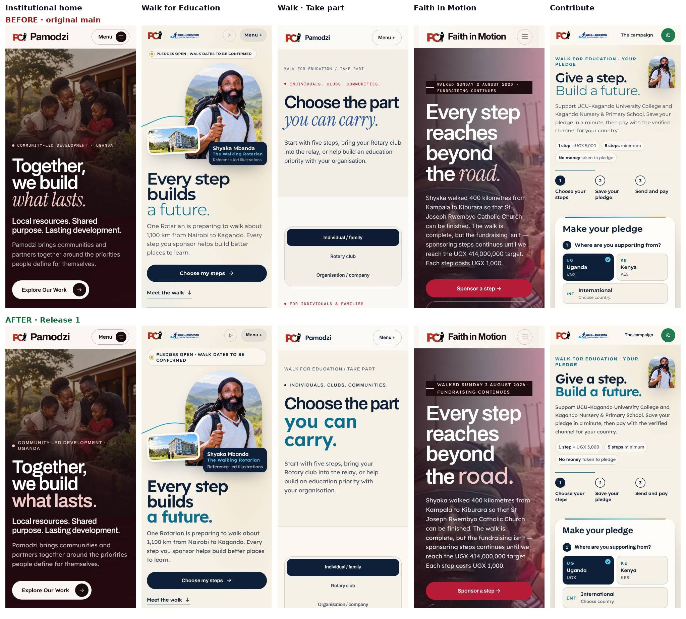

# Release 1, 21 October 2026

What changed, what was tested, what was deliberately left alone, and how to undo it. This is the pack to forward for approval. The numbers before the release are in [BASELINE-2026-10-21.md](BASELINE-2026-10-21.md).

## 1. What changed, in plain words

1. **One type system on every page.** Headings, menus, buttons, labels and figures are set in Archivo; everything else in Lexend. No italics anywhere. Before, the three sites used eight different fonts. The two new fonts are self-hosted and weigh 74.6 KB together.
2. **One look for Walk for Education.** The home page, the four inner pages and the contribution pages now share one palette (ivory, navy, gold and cyan). The inner pages used to be red and blue, which made the campaign look like two sites.
3. **No loading screen.** Pages used to hold a full-screen logo for at least 0.9 seconds on a first visit. They now paint at once.
4. **A clearer header on the institutional site.** Five groups (Our work, Impact and trust, Partner with us, Updates, About) with light dropdowns that work by keyboard and as plain links without JavaScript, a campaign chip, and a Contact button. On phones the menu shows the groups under headings.
5. **The site follows the campaign.** The home page, the header chip and the projects list now read the campaign's status from the campaign record, so they cannot disagree with it. The home page said "walk dates *un*confirmed" while the record said "to be confirmed"; both now say what the record says. A confirmed date, "Day 9 on the road" and the arrival state are built in and tested, and appear only when the record has the facts.
6. **Fixes for real problems found in the baseline.** The contribution privacy and terms pages no longer scroll sideways on phones. Every page now holds up at 200% text size. Nothing is smaller than 13 px. Tap targets in the pledge help panel are comfortable.
7. **A share card for every page.** A link to a Walk or Faith in Motion page on WhatsApp now shows that page's own card. Before, ten pages shared one generic image, and Faith in Motion pages were labelled "Together for Development — Uganda".
8. **A design-system page generated from the tokens**, for both brands, with every contrast ratio computed.
9. **A generated sitemap**, so a new page appears and a removed one disappears without anyone editing a file.

## 2. Gate results

| Check | Before | After |
| --- | --- | --- |
| `npm run validate` (types, build, lint, formatting, protected files, 23 page and navigation tests, all new gates) | Pass | Pass |
| Ledger tests | 81 checks | 81 checks |
| Payment HTTP tests | 54 checks | 54 checks (see section 6 about one flaky assertion) |
| Enquiry tests | Pass | Pass |
| Payments and pledge browser suite | 181 checks | **184 checks** (the tests that asserted the loading screen and the old font now assert the new contract) |
| Walk redesign suite | 25 | 25 |
| Institutional and motion suites | Pass | Pass |
| Accessibility (axe, WCAG 2.2 A and AA) | 0 violations | **0 violations**, 30 pages at 1440 and 390 px |
| Responsive, 30 pages x 10 viewports | 36 of 300 measurements failed | **0 of 300 fail** (`--strict`, now enforced in CI) |
| Text under 13 px | all 30 pages | **none** |
| Hooks gate (17 protected pages) | Recorded | Match; the only difference is the removed loading screen's `data-variant` |
| Fragments gate (11 frozen blocks) | Recorded | **Byte-identical** |
| Facts gate | Agrees | Agrees |
| Links gate | Clean | Clean, 25 different share cards across 27 pages (was 14) |

## 3. Speed, throttled phone lab test

The same command and the same budget profile as the baseline. Lab numbers move by up to about half a second between runs; the Walk home was measured five times on both versions to be sure of the difference.

| Page | LCP before | LCP after | KB before | KB after | Blocking before | Blocking after |
| --- | --- | --- | --- | --- | --- | --- |
| `/` | 1916 | **1680** | 309 | **268** | 580 | **380** |
| `/about/` | 2512 | 2816 | 209 | **168** | 349 | **135** |
| `/projects/` | 3040 | **2844** | 327 | **286** | 242 | **106** |
| `/walk-for-education/` | 2316 | 3108 | 303 | 341 | 497 | **450** |
| `/walk-for-education/take-part/` | 3172 | **2332** | 354 | **313** | 227 | **107** |
| `/contribute/` | 1388 | 1476 | 178 | 216 | 148 | 230 |
| `/faith-in-motion/` | 3836 | **3708** | 731 | **700** | 395 | **353** |
| `/give/` | 2908 | **2616** | 465 | **412** | 200 | **181** |

Most pages are the same or faster. Two pages carry a real cost: the Walk home and the contribution page are about 38 KB heavier, because two fonts (74.6 KB) replace one (38 KB). In a five-run comparison against the original code the Walk home measured about 150 ms slower. It still meets its targets (LCP 2.5 s, 450 KB). The ceilings in `tests/quality/budget.json` were lowered to these results plus 15%, and only move down.

## 4. Unchanged on purpose

- **No pledge, price, bound, referral, session, ledger or payment code changed.** No PHP file changed. `api/` is byte-identical to the previous `main`.
- **The ten protected Walk and Contribute pages are byte-identical to the previous `main` apart from their `<head>` and the removed loading-screen block**, proved mechanically for every page. Their IDs, forms, scripts and the 11 frozen blocks (pledge chooser, payment channel cards, certificate rules, enquiry and pledge forms, status notices) are unchanged.
- **One protected script was edited**, `js/preloader.js`, to retire the loading screen. It keeps the contract other scripts use (`PamodziPreloader.whenDone`, the `pamodzi:preloaded` event, `html.is-preloaded`). It contains no pledge, price or payment logic. Each protected file changed has a recorded review in `tests/protected-campaign/baseline.json`.
- **No public URL was added, renamed or removed.**
- The admin consoles, the Faith in Motion register and its scripts are untouched.

## 5. How to undo it

The previous production release is commit **`5b65383`** ("Keep the campaign journey inside the screen on every phone"). To roll back, revert the release commits on `main` (or reset `main` to `5b65383`); the deploy workflow then uploads the previous files. Nothing in the release changes data, so there is nothing to restore. A tag for that commit (`pre-release-1-2026-10-21`) could not be pushed from the session that prepared the release, so it does not exist on GitHub yet; create it with `git tag pre-release-1-2026-10-21 5b65383 && git push origin pre-release-1-2026-10-21` if you want a named marker.

## 6. Other things worth knowing

- **A flaky test was fixed.** `tests/payments/test_http.py` assumed a pledge it had just closed was the first row on the dashboard. Several fixtures are created within one second, so the order is not guaranteed and the test failed about one run in thirteen, on the original code too. It now finds the row by its reference. Twelve consecutive runs pass. The deploy workflow runs this test, so the flake could have blocked a release at random.
- **Dependency audit.** `npm audit` reports 10 findings (1 critical, 8 high, 1 low), all in build-time tooling (Astro, sharp, esbuild, stylelint). They need a breaking upgrade to Astro 7 and none reaches visitors, because the site is static files. CI now reports them without failing, and Dependabot is configured to propose updates.
- **The header breakpoint is 1200 px** (decision D3). Below it, the menu button is shown.
- **Still open from the responsive gate (advisory, not failures):** 34 images on 12 pages, 19 of them on the Faith in Motion home, have no `width` and `height` attributes, so they can shift while loading; and two buttons truncate rather than wrap at 200% text on the contribution and Walk home pages. Neither blocks anything; both are listed by `node tests/quality/responsive.cjs`.
- **Arrow glyphs** (→ ↗ ✓) are not in either font and fall back to the system font, as they did with the previous fonts.

## 7. What is not done, and why

| Item | Why |
| --- | --- |
| Migrate the Walk and Contribute pages into Astro (decision D7) | These are the live pledge and payment pages. The plan calls for one page at a time with an equivalence proof, a preview on a phone, a quiet-hour cutover and a 48-hour watch. Doing all ten in one release would skip those safeguards. The equivalence tooling now exists. |
| Gallery page, trimmed Walk home (D10) | The Walk home already meets its budget and its gallery images load lazily; moving the gallery touches the protected gallery script on the live page. Revisit with the migration. |
| Route page | It appears only when verified stages exist; there are none. |
| Cloudflare, headers, caching, backups, analytics and real-user measurement (D15) | They need the host, DNS or an analytics account, and a choice of tool. The redirect rule for the eighteen old `.html` links is ready in `SERVER-CONFIG-PACK.md`. |
| Stop committing generated HTML (D23) | It changes the deployment pipeline and waits for the migration. |
| Real photographs of the Walking Rotarian on the road and the campus | They do not exist yet. |
| Fewer breakpoints in the old stylesheets | 35 widths remain outside the three decided; the responsive gate passes at every tested width. They retire as each stylesheet does. |
